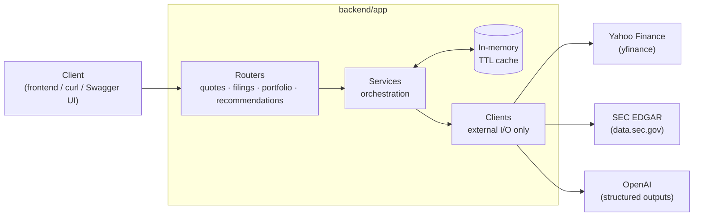
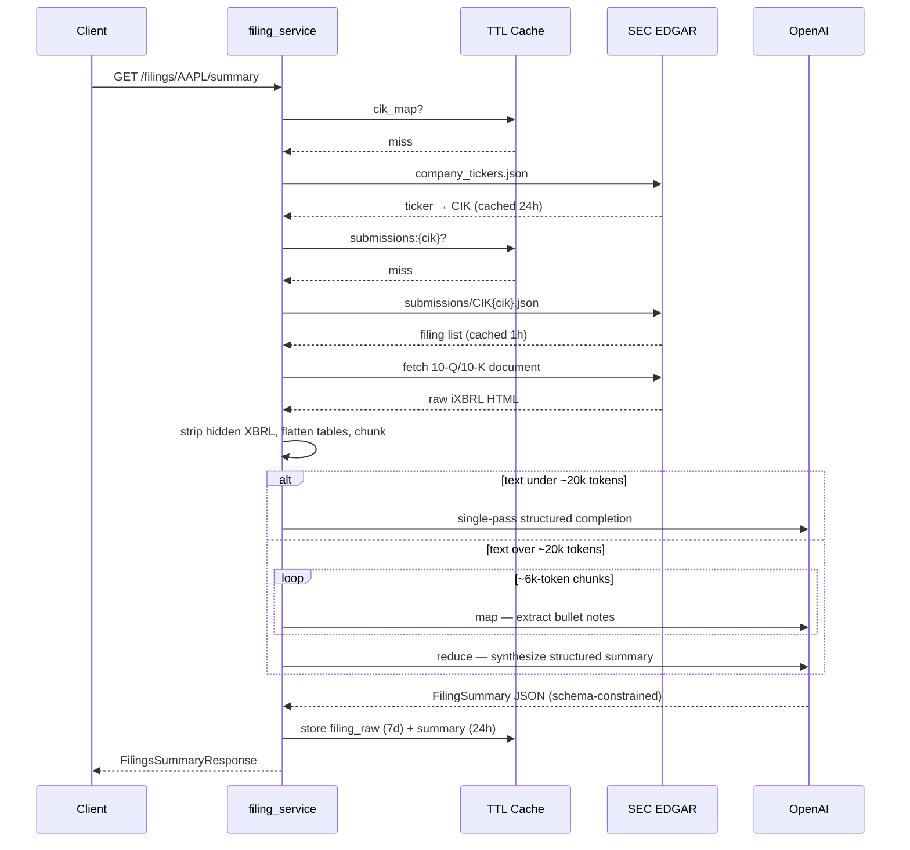
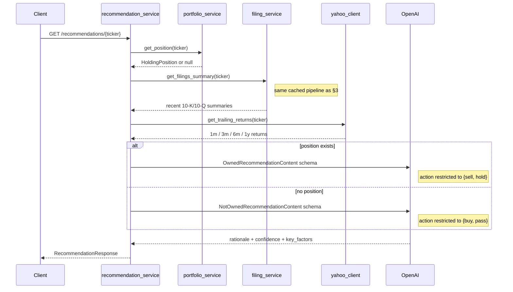
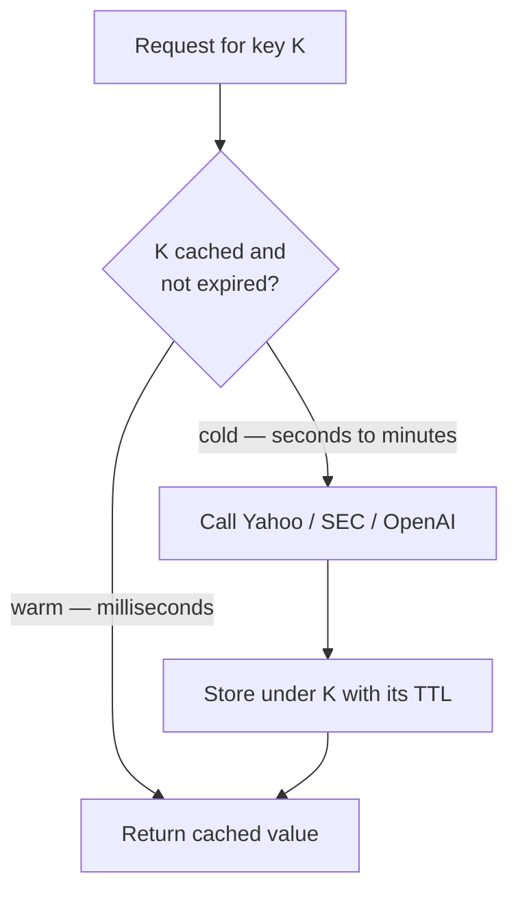
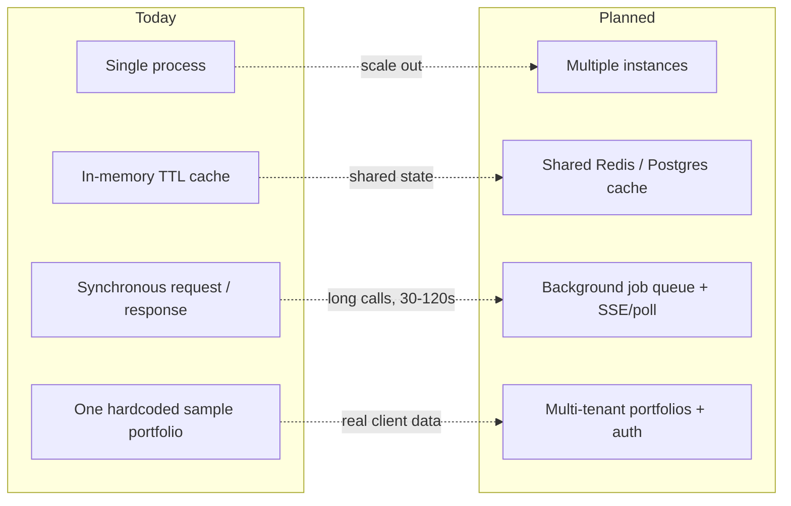

# Portfolio Intelligence API — Architecture

Architecture of the FastAPI service that gives advisors live quotes, AI-read SEC filings, and
grounded buy/sell/hold guidance — how it's built, how to call it well, and where it goes next.

- **Stack**: FastAPI, Python 3.11
- **Data sources**: Yahoo Finance, SEC EDGAR
- **Reasoning**: OpenAI, structured outputs
- **State**: v1 — stateless, in-memory TTL cache

## Contents

1. [Overview](#1-overview)
2. [Quotes](#2-quotes)
3. [Filing Summaries](#3-filing-summaries)
4. [Portfolio](#4-portfolio)
5. [Recommendations](#5-recommendations)
6. [Caching Strategy](#6-caching-strategy)
7. [Errors & Config](#7-errors--config)
8. [Using It Well](#8-using-it-well)
9. [Roadmap](#9-roadmap)

## 1. Overview

The service answers one question for a wealth-management team: *what do I need to know about
this stock, right now?* It layers four capabilities, each reusing the one below it:

| Endpoint | Answers | Reuses |
|---|---|---|
| `GET /quotes/{ticker}` | What's it trading at? | — |
| `GET /filings/{ticker}/summary` | What did the company just say in its 10-K/10-Q? | — |
| `GET /portfolio` | What do we hold, and what's it worth today? | Quotes |
| `GET /recommendations/{ticker}` | Should we buy, sell, hold, or pass? | Portfolio, Filings, Quotes |

Internally the code is layered the same way it's used: **routers** handle HTTP, **services**
orchestrate and read/write the cache, **clients** are the only code that talks to Yahoo, SEC, or
OpenAI.



*Fig. 1 — Every external call is made by a client module; every repeat call for the same key is
answered by the cache instead.*

## 2. Quotes

`GET /quotes/{ticker}` returns a current price snapshot sourced from Yahoo Finance's `.info`
payload — price, previous close, change, market state, currency, company name. It's the
cheapest, fastest call in the API and the one every other endpoint leans on for valuation.

```
$ curl /quotes/AAPL
{
  "ticker": "AAPL", "price": 336.64, "change_percent": -1.11,
  "previous_close": 340.42, "market_state": "CLOSED",
  "as_of": "2026-10-09T20:00:01Z", "source": "yahoo_finance"
}
```

Unknown tickers return `404 ticker_not_found` rather than a payload full of nulls — Yahoo's own
response for a bad symbol is an almost-empty dict, so the client checks for the presence of
`price`/`currency` before trusting it.

## 3. Filing Summaries

`GET /filings/{ticker}/summary` turns a company's most recent 10-K/10-Q filings into a
structured brief: a TL;DR, overview, financial highlights, notable risks, sentiment, and
confidence — never freeform prose, so a UI can render it consistently every time.

Getting there means walking the whole SEC EDGAR chain — ticker → CIK → filing list → raw
document — then deciding how to feed a document that can run past 40,000 tokens into a model
economically:



*Fig. 2 — A 10-Q usually clears in one model call; a 46k-token 10-K is chunked, summarized
piecewise, then reduced to one structured result.*

Two details matter for correctness, not just performance:

- **Hidden XBRL noise.** SEC filings are inline-XBRL — the visible 10-Q text sits alongside a
  non-rendered `<ix:header>` block and scattered `display:none` tags carrying raw accounting
  facts. Left in, they roughly double the token count for no benefit; they're stripped before
  chunking.
- **Tables are flattened, not dropped.** Revenue, margin, and EPS figures live almost entirely
  inside `<table>` elements. Each row becomes one pipe-separated text line rather than being
  discarded with the rest of the markup.

Query params tune the pull: `forms` (default 10-K + 10-Q — the only types supported today),
`limit` (default 2, capped at 5 to bound OpenAI spend per request), `lookback_months`
(default 18).

## 4. Portfolio

`GET /portfolio` reads the firm's sample book — tax-lot-level holdings in
`data/sample_portfolio.json` — and prices it live. The file stores only what was paid and when;
current value, unrealized gain/loss, and portfolio totals are computed on every request from a
fresh quote, never stored.

| Field | Source |
|---|---|
| `total_shares`, `total_cost_basis` | Summed across each ticker's tax lots |
| `current_price`, `market_value` | Live quote × total shares |
| `unrealized_gain_loss(_pct)` | market_value − cost basis |
| `total_market_value` | Σ holdings + cash |

This is also what makes `/recommendations/{ticker}` "ownership-aware" — the same aggregation is
reused to answer, for any ticker, whether the firm already holds it.

## 5. Recommendations

`GET /recommendations/{ticker}` is the product this whole API exists to support: one call,
grounded in the filing summary, trailing price performance, and — if held — the actual
position, resolving to a single action.

The ownership split isn't just a prompt instruction — it's structural. Two separate schemas are
handed to OpenAI depending on whether the position exists, so the model is *constrained* to
`hold`/`sell` when owned and `buy`/`pass` when not. It cannot recommend buying a position the
firm already carries, or selling one it never bought.



*Fig. 3 — Nothing new is fetched here: filings and quotes are the same cached calls as §2–§4,
only the prompt and schema change.*

**Example — owned position**

```
$ curl /recommendations/AAPL
{ "owned": true, "action": "hold", "confidence": "high",
  "rationale": "+403% unrealized gain, +33% trailing 1y return; filings
   show strong revenue growth despite supply-chain and tariff risk.",
  "position": { "unrealized_gain_loss_pct": 403.2, "avg_price_per_share": 66.90 } }
```

**Example — not held**

```
$ curl /recommendations/GOOGL
{ "owned": false, "action": "buy", "confidence": "high",
  "rationale": "Net income up 4x YoY, +46% trailing 1y return, positive
   filing sentiment — a reasonable entry point.",
  "position": null }
```

## 6. Caching Strategy

Every expensive call — SEC fetch, text extraction, OpenAI completion — sits behind the same
cache-aside pattern: check, and only call out on a miss.



*Fig. 4 — The gap between a cold and warm call is the entire point of the cache: a
recommendation request can drop from ~60s to ~2ms on repeat.*

| Cache key | TTL | Why that long |
|---|---|---|
| `quote:{ticker}` | 45s | Prices move constantly; just dedupes rapid repeats |
| `cik_map` | 24h | SEC's bulk ticker→CIK file changes rarely |
| `submissions:{cik}` | 1h | New filings appear sporadically |
| `filing_raw:{accession}` | 7d | A published filing never changes |
| `summary:{accession}` | 24h | Avoids re-paying for the same OpenAI call |
| `portfolio_raw` | 24h | Static local file; just avoids re-parsing |
| `performance:{ticker}` | 1h | Trailing returns only move day to day |
| `recommendation:{ticker}:{owned}` | 1h | Reflects daily price moves without re-reasoning |

The cache itself is a small `Protocol` (`get` / `set` / `get_or_set`) with one in-memory
implementation behind it. Every service depends on the protocol, not the class — swapping in
Redis later is a new implementation wired in one place, not a rewrite. See
[Roadmap](#9-roadmap).

## 7. Errors & Config

### Error responses

| Condition | Status | `error` code |
|---|---|---|
| Ticker not found (Yahoo or SEC) | 404 | `ticker_not_found` |
| No 10-K/10-Q within the lookback window | 404 | `no_recent_filings` |
| SEC or Yahoo request fails after retry | 502 | `upstream_service_error` |
| OpenAI call fails or returns off-schema | 502 | `summarization_failed` |

`/filings/{ticker}/summary` degrades partially: if one filing fails to summarize, it's dropped
into a `warnings` array and the rest of the response still returns. Only a 404/502 if *every*
filing fails, or none exist.

### Configuration

| Variable | Default | Purpose |
|---|---|---|
| `SEC_CONTACT_EMAIL` | — (required) | Sent in the User-Agent on every EDGAR request, per SEC policy |
| `OPENAI_API_KEY` | — (required) | |
| `OPENAI_MODEL` | `gpt-4o-mini` | Swappable without a code change |
| `sec_requests_per_second` | 8 | Local throttle, under SEC's ~10 req/s guidance |
| `max_filings_per_request` | 5 | Hard cap regardless of the `limit` query param |

## 8. Using It Well

> **Latency is bimodal — design the UI for it.**
> A first call to `/filings` or `/recommendations` for a given ticker can take **30–120
> seconds** (SEC fetch, text extraction, one or more OpenAI calls for a large 10-K). The same
> call seconds later, within the TTL, returns in **single-digit milliseconds**. Build a real
> loading state for the first call — don't assume a quick response.

- **Call `/recommendations` directly** — it already pulls filings and quotes internally.
  Calling `/filings` first doesn't save work, though it does warm the shared cache if you
  expect the user to open both views.
- **Tune `/filings`, not `/recommendations`.** `forms`/`limit`/`lookback_months` only apply to
  the filings endpoint — recommendations always reason over the latest 2 filings, 10-K/10-Q, 18
  months. Making that configurable is on the roadmap ([§9](#9-roadmap)).
- **State lives in one process.** The TTL cache is in memory — it resets on every
  restart/redeploy and isn't shared if the API ever runs as more than one instance. Fine for a
  single dev/demo process today; see §9 for what changes before that's no longer true.
- **Set a real `SEC_CONTACT_EMAIL`.** It's sent on every EDGAR request; SEC can and does
  rate-limit or block traffic that doesn't identify a contact.

## 9. Roadmap

v1 made deliberate simplicity trade-offs to ship fast. None are wrong for a single-process
demo; all four are the first things to revisit before this handles real concurrent users.



*Fig. 5 — Each arrow is a real constraint today, not a hypothetical: the four items on the
right are what remove it.*

**Near-term**

- Background job queue for `/filings` and `/recommendations` — return a job id immediately, let
  the client poll or subscribe instead of holding a 60–120s connection open
- Shared cache (Redis) so the API can run as more than one instance
- Configurable filing scope (forms/limit/lookback) for recommendations, matching what
  `/filings` already exposes
- Streaming the recommendation rationale token-by-token for better perceived latency

**Further out**

- Multi-tenant portfolios with auth, replacing the single sample JSON file
- Whole-portfolio recommendation batch endpoint, not one ticker at a time
- 8-K and proxy statement (DEF 14A) coverage alongside 10-K/10-Q
- Benchmark-relative performance (vs. S&P 500 / sector ETF), not just absolute trailing returns
- Tax-lot-aware sell guidance — short- vs. long-term capital gains impact per lot
- Usage/cost observability for OpenAI spend per request
